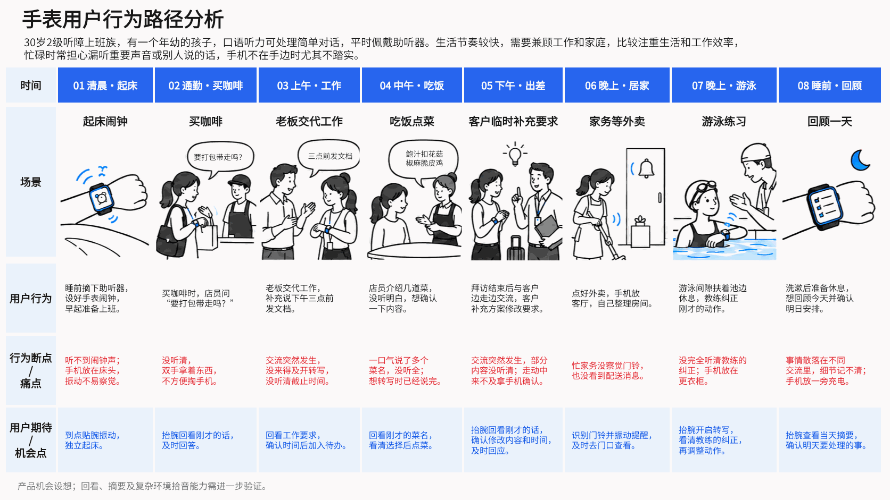

# 用户旅程分析

围绕一个角色、场景和目标，还原从起念到结果的过程，区分证据与假设，将体验问题转为可验证的产品机会。

## 使用方法

提供目标用户、任务场景、产品决策和已有材料，例如：

> 分析上班族工作日午间点外卖的现状旅程，目标是 20 分钟内吃到午饭。根据访谈和订单数据，梳理行为、触点、想法、痛点与情绪，提出机会及验证方法。缺少证据的地方标为待验证。

默认交付旅程矩阵、机会验证表及来源/待验证项；也支持一天场景盘点、图片和可编辑 PPTX。执行规则见 [SKILL.md](SKILL.md)。

## 既有场景示例

以下为听障用户腕上辅助的**假设场景盘点**，用于讨论手表相对手机的情境价值；不是研究结论，也不是同一目标的完整旅程。具体能力前提见 [案例](references/examples.md)。

